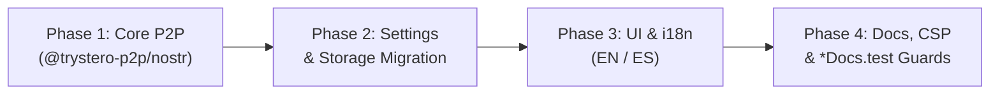

# Migration Plan: WebTorrent (`@trystero-p2p/torrent`) to Nostr (`@trystero-p2p/nostr`)

| Field | Detail |
| :--- | :--- |
| **Status** | Detailed Proposal — Ready for phased implementation |
| **Date** | 2026-10-18 |
| **Objective** | Migrate the WebRTC signaling transport of the Gritos client from WebTorrent trackers to Nostr relays (NIP-01) using Trystero's default public relays and custom relay configuration support |
| **Companion Document** | [`docs/nostr-relay-plan.md`](file:///Users/juliangarciatunon/proyectos/gritos/docs/nostr-relay-plan.md) (self-hosted ephemeral Nostr micro-relay server) |
| **Cross-cutting Rule** | Every phase is **small, atomic, and self-validated**: upon completion of each phase, `npm run build`, `npm run lint`, and `npm test` must pass 100% with zero errors |

---

## 1. Executive Summary and Architecture

Currently, **Gritos** uses `@trystero-p2p/torrent@0.25.4` to discover peers and exchange WebRTC SDP offers/answers via public WebTorrent trackers (`wss://`).

Thanks to the architectural invariant defined in `docs/plan.md` (§3):
> *"Trystero is imported **only** from `src/lib/p2p/roomManager.ts`"*

the rest of the application (E2EE cryptography in `src/lib/crypto/`, envelope protocol and deduplication in `src/lib/p2p/protocol.ts`, file transfer, auxiliary signal channel in `src/lib/p2p/signalChannel.ts`, and serverless manual DMs in `src/lib/p2p/manualPeer.ts`) **is completely agnostic to the signaling transport mechanism**.

Furthermore, in Trystero `0.25.4`, both `@trystero-p2p/torrent` and `@trystero-p2p/nostr` are built on top of `@trystero-p2p/core@0.25.4` and export **the exact same public interface**:
- `joinRoom(config, roomId, callbacks)`
- `selfId`
- `getRelaySockets()`
- `defaultRelayUrls`
- `pauseRelayReconnection()` / `resumeRelayReconnection()`
- `config.relayConfig = { urls: string[], redundancy?: number }`

This allows structuring the client migration into **4 small, self-validated phases**, ensuring zero regressions at each step:



> **Note on self-hosting backends**: For implementing a self-hosted ephemeral Nostr micro-relay (an in-memory WebSocket server for local development, E2E tests, or private networks), see the companion plan in [`docs/nostr-relay-plan.md`](file:///Users/juliangarciatunon/proyectos/gritos/docs/nostr-relay-plan.md).

---

## 2. Invariants that MUST NOT Change

1. **Trystero Isolation**: Only `src/lib/p2p/roomManager.ts` may import `@trystero-p2p/nostr`.
2. **Exact Version Pinning**: In `package.json`, `@trystero-p2p/nostr` must be pinned to `"0.25.4"` (no `^` or `~` prefixes), adhering to the repository's strict supply-chain policy.
3. **Cryptography and Privacy**: `deriveRoomId(name, password?)` in `src/lib/crypto/hashes.ts` continues to derive opaque identifiers so that Nostr relay operators never learn the real room name or password (RF-05).
4. **Reachability Heuristic (§10.3 / issue #125)**: The live socket reachability check (`readyState === 1` via `getRelaySockets()`) after 15 seconds and the empty room hint (`peerlessHint`) must retain their exact behavior.
5. **Manual CI**: Do not modify `.github/workflows/ci.yml` (`on: workflow_dispatch`).

---

## 3. Phased Implementation Plan

---

### Phase 1: P2P Transport Engine Swap in `roomManager.ts` & Dependencies

**Goal**: Replace the `@trystero-p2p/torrent` dependency with `@trystero-p2p/nostr` at the network layer without modifying store contracts, UI, or text yet, keeping the entire existing test suite green.

#### Tasks
- [ ] **1.1. Update dependencies**:
  - In `package.json`, replace `"@trystero-p2p/torrent": "0.25.4"` with `"@trystero-p2p/nostr": "0.25.4"`.
  - Run `npm install` to update `package-lock.json`.
- [ ] **1.2. Update imports in `src/lib/p2p/roomManager.ts`**:
  - Update the import block on lines 1–8:
    ```typescript
    import {
      getRelaySockets,
      joinRoom as trysteroJoinRoom,
      selfId as trysteroSelfId,
      type JoinRoomConfig,
      type MessageAction,
      type Room as TrysteroRoom,
    } from '@trystero-p2p/nostr'
    ```
  - Verify that `buildSwarmConfig(settings)` continues to pass `config.relayConfig = { urls: [...settings.trackers] }` when custom URLs are configured.
- [ ] **1.3. Update comments in `tests/fakeTrystero.ts`**:
  - Document that the `setJoinRoomFactory` test seam replaces `@trystero-p2p/nostr`.

#### Tests to create / update in Phase 1
- [ ] **Dependency contract guard in `tests/roomManager.test.ts`**:
  - Assert via `package.json?raw` that `@trystero-p2p/nostr` is pinned with an exact version (`^\d+\.\d+\.\d+$`) and `@trystero-p2p/torrent` is absent from `dependencies`.
  - Assert that `defaultRelayUrls` exported by `@trystero-p2p/nostr` contains only valid `wss://` URLs.
- [ ] Verify that all existing roomManager tests (`tests/roomManager*.test.ts`) pass without modification.

#### Self-Validation Commands (Phase 1 Exit Criteria)
```bash
npm test -- tests/roomManager.test.ts tests/roomManagerPassword.test.ts tests/roomManagerDm.test.ts
npm run lint
npm run build
```

---

### Phase 2: Configuration Sanitization & `localStorage` Migration

**Goal**: Ensure that if a user has legacy WebTorrent tracker URLs stored in `localStorage` (`gritos:settings`), or imports a legacy settings JSON file, the normalizer strips incompatible tracker URLs and accepts Nostr `wss://` relays cleanly.

#### Tasks
- [ ] **2.1. Update `src/lib/validateSettings.ts`**:
  - Keep the `isValidTrackerUrl` check (and export an `isValidRelayUrl` alias) requiring `wss://` schemes with valid hosts.
  - In `normalizeTrackers(value)` (or `normalizeRelays`):
    - Add a blocklist of the 5 legacy WebTorrent default trackers (`wss://open.ftorrent.com`, `wss://tracker.webtorrent.dev`, `wss://tracker.openwebtorrent.com`, `wss://tracker.btorrent.xyz`, `wss://tracker.files.fm:7073/announce`) so that, if persisted in a browser's `localStorage`, they are automatically evicted back to `[]` (which activates Nostr's `defaultRelayUrls`).
    - Optionally accept `relays` as an input alias in `normalizeSettings(raw)` when importing settings, normalizing into the `Settings` structure.

#### Tests to create / update in Phase 2
- [ ] **In `tests/settingsValidation.test.ts`**:
  - Unit test: verifies that Nostr relay URLs (`wss://relay.damus.io`, `wss://nos.lol`) are preserved.
  - Migration unit test: verifies that if `localStorage` contains any of the 5 legacy default WebTorrent trackers, `normalizeSettings` discards them so NIP-01 messages are not sent to BitTorrent servers.
  - Unit test: verifies support for the `relays` input alias when importing/hydrating settings.

#### Self-Validation Commands (Phase 2 Exit Criteria)
```bash
npm test -- tests/settingsValidation.test.ts tests/settingsStore.test.ts tests/settingsPersistence.test.ts tests/localStorageInvariant.test.ts
npm run lint
npm run build
```

---

### Phase 3: UI Copy & Internationalization Updates (EN / ES)

**Goal**: Update user-facing copy in English (`src/i18n/en.ts`) and Spanish (`src/i18n/es.ts`), along with network settings placeholders, to refer to **Nostr relays** instead of "torrent network".

#### Tasks
- [ ] **3.1. Update strings in `src/i18n/en.ts` and `src/i18n/es.ts`**:
  - `chat.searchingStatus`:
    - EN: `'Searching for peers on Nostr relays…'`
    - ES: `'Buscando pares en los relays Nostr…'`
  - `settings.emptyTrackersHint`:
    - EN: `'Empty list: Trystero’s default Nostr relays are used.'`
    - ES: `'Lista vacía: se usan los relays Nostr predeterminados de Trystero.'`
  - In `src/components/settings/NetworkTab.tsx`:
    - Update placeholder to `wss://relay.example:443` or preserve expected test patterns.
- [ ] **3.2. Synchronize re-exported constants in `src/components/settings/messages.ts`**:
  - Ensure exported constants consumed by components and test assertions reflect the updated `en.ts` copy.

#### Tests to create / update in Phase 3
- [ ] Update exact-string assertions in:
  - `tests/i18nCopy.test.ts`
  - `tests/i18nSpanish.test.ts`
  - `tests/i18n.test.ts` (verifies 1:1 key and interpolation parity between EN and ES)
  - `tests/chatState.test.ts`
  - `tests/peerlessHint.test.tsx`
  - `tests/settingsModal.test.tsx`

#### Self-Validation Commands (Phase 3 Exit Criteria)
```bash
npm test -- tests/i18n.test.ts tests/i18nCopy.test.ts tests/i18nSpanish.test.ts tests/i18nComponents.test.tsx tests/peerlessHint.test.tsx tests/settingsModal.test.tsx tests/chatState.test.ts
npm run lint
npm run build
```

---

### Phase 4: Documentation, Security Reference, Runbook & Guards (`*Docs.test.ts`)

**Goal**: Update the repository's technical and security documentation along with static test guards (`tests/trackersDoc.test.ts`, `tests/pwaDocs.test.ts`, `tests/manualDmDocs.test.ts`) to accurately document the effective default Nostr relays of `@trystero-p2p/nostr@0.25.4`.

#### Tasks
- [ ] **4.1. Inspect `defaultRelayUrls` in `@trystero-p2p/nostr@0.25.4`**:
  - Extract the exact list of `wss://` URLs from `node_modules/@trystero-p2p/nostr/dist/index.mjs`.
- [ ] **4.2. Update `docs/security.md`**:
  - In the public relay notice section, document the effective default Nostr relays of `@trystero-p2p/nostr@0.25.4` and explain that relay operators observe only WebSocket transport metadata and ephemeral events with opaque SHA-256/PBKDF2-derived topics.
- [ ] **4.3. Update `docs/runbook-trackers.md`, `docs/architecture.md`, `docs/spec.md`, and `index.html`**:
  - In `docs/runbook-trackers.md`, document health verification of Nostr relays (`wss://`) using `wscat` by sending a NIP-01 subscription `["REQ", "test", {"kinds": [1], "limit": 1}]` and expecting `["EOSE", "test"]`.
  - Preserve all pinned keywords enforced by `tests/manualDmDocs.test.ts` and `tests/trackersDoc.test.ts` (such as the issue #125 socket check and the trackerless manual DM shortcut).
  - Update the CSP comment in `index.html` regarding the `connect-src 'self' wss:` directive.

#### Tests to create / update in Phase 4
- [ ] **In `tests/trackersDoc.test.ts`**:
  - Update the default relay array to match `@trystero-p2p/nostr@0.25.4`'s `defaultRelayUrls`.
  - Add a test that dynamically imports `defaultRelayUrls` from `@trystero-p2p/nostr` and asserts that **every** library default is documented in `docs/security.md` (preventing silent drift on future dependency bumps).
- [ ] Verify that `tests/pwaDocs.test.ts`, `tests/manualDmDocs.test.ts`, `tests/signalChannelDocs.test.ts`, `tests/qrDocs.test.ts`, and `tests/buildOutput.test.ts` pass 100%.

#### Self-Validation Commands (Phase 4 Exit Criteria)
```bash
npm test -- tests/trackersDoc.test.ts tests/pwaDocs.test.ts tests/manualDmDocs.test.ts tests/signalChannelDocs.test.ts tests/securityPolicy.test.ts
npm run build
npm test -- tests/buildOutput.test.ts
```

---

## 4. Final Verification Matrix (Global Definition of Done)

Upon completing the 4 client migration phases, verify the following checklist before considering the migration complete:

- [ ] `npm test` passes 100% of the repository's test files (including all `*Docs.test.ts`).
- [ ] `npm run lint` finishes with 0 errors and 0 warnings.
- [ ] `npm run build` compiles TypeScript (`tsc -b`) and produces the production bundle in `dist/` without warnings, passing `tests/buildOutput.test.ts`.
- [ ] **Manual verification across 2 browser tabs (default public relays)**:
  - Open two browser tabs/windows in the same room → verify transition from `searching` to `connected` → exchange chat messages, reactions, file transfers, and E2EE DMs.
- [ ] **Custom relay UI verification**:
  - Configure a custom Nostr relay URL (`wss://...`) in **Settings > Network** → verify room reconnects and establishes peer connectivity over the specified relay.
