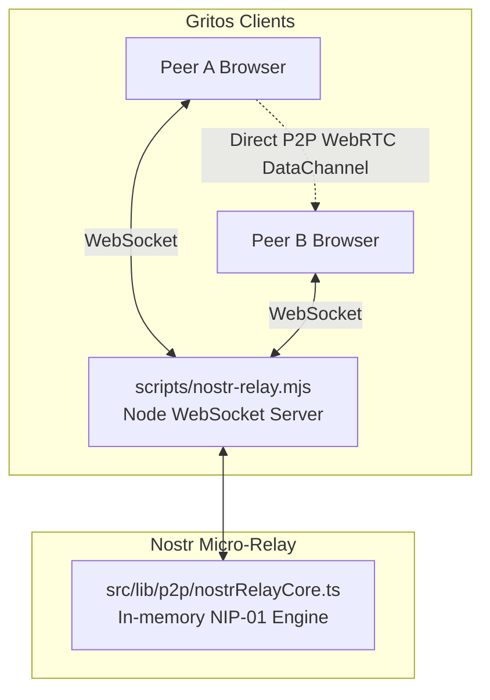

# Development Plan: Ephemeral Nostr Micro-Relay (Cross-Platform)

| Field | Detail |
| :--- | :--- |
| **Status** | Detailed Proposal — Standalone Companion Plan |
| **Date** | 2026-10-18 |
| **Objective** | Build a lightweight in-memory, database-free Nostr (NIP-01) relay server running seamlessly on Windows, Linux, and macOS, tailored for WebRTC signaling and automated E2E tests |
| **Companion Document** | [`docs/nostr-migration-plan.md`](file:///Users/juliangarciatunon/proyectos/gritos/docs/nostr-migration-plan.md) (Gritos client migration from WebTorrent to Nostr) |
| **Cross-cutting Rule** | Decoupled architecture: pure TypeScript NIP-01 protocol & filter matching engine fully testable in Vitest (zero port binding in unit tests), paired with an ultra-lightweight Node.js WebSocket CLI server |

---

## 1. Motivation and Architecture

For WebRTC peers using `@trystero-p2p/nostr` to exchange SDP offers/answers and ICE candidates, the backend only needs to implement the minimal subset of **Nostr NIP-01** (the `REQ`, `EVENT`, `CLOSE`, `EOSE`, and `OK` wire messages).

Unlike a full social-media Nostr relay (which requires persistent storage in SQLite/PostgreSQL, full-text indexing, and user profiles), a **WebRTC signaling relay is strictly ephemeral**:
1. Signaling packets are single-use; once browsers connect P2P, the event has zero historical value.
2. All state lives purely in RAM (active subscription maps keyed by socket/client ID).
3. Zero native C++ compilation or external databases: runs identically on **Windows, Linux, and macOS**.



---

## 2. Project Components

### 2.1. In-Memory NIP-01 Protocol Engine (`src/lib/p2p/nostrRelayCore.ts`)
- Pure TypeScript with zero network or filesystem dependencies.
- Allows 100% of protocol edge cases to be tested instantly in Vitest without binding live sockets.
- **Responsibilities**:
  - `handleMessage(clientId: string, rawText: string): RelayResponse[]`
    - Safe parser with protection against malformed JSON and oversized payloads.
    - Support for `["REQ", subscriptionId, ...filters]`:
      - Validates and registers the client's subscriptions.
      - Returns `["EOSE", subscriptionId]`.
    - Support for `["EVENT", event]`:
      - Validates required event envelope fields (`id`, `pubkey`, `created_at`, `kind`, `tags`, `content`, `sig`).
      - Returns `["OK", event.id, true, ""]` to the publisher (NIP-20).
      - Performs filter matching against other clients' active subscriptions and emits `["EVENT", subId, event]` exclusively to matching peers.
    - Support for `["CLOSE", subscriptionId]`:
      - Removes the specified subscription.
  - `removeClient(clientId: string): void`
    - Drops all subscriptions registered by a disconnected client (prevents memory leaks).
  - `getStats(): RelayStats`
    - Exposes counts for connected clients, active subscriptions, and dispatched events.

### 2.2. WebSocket CLI Server (`scripts/nostr-relay.mjs`)
- Minimal Node.js (>=20) runner wrapping a `WebSocketServer`.
- Assigns a unique `clientId` to each incoming socket connection.
- Pipes raw network events (`message`, `close`, `error`) into `nostrRelayCore`.
- Configurable port via environment variables (`PORT=8000` by default).
- Script hook in `package.json`:
  ```json
  "scripts": {
    "relay": "node scripts/nostr-relay.mjs"
  }
  ```

---

## 3. Implementation Phases

---

### Phase R1: Pure NIP-01 Engine & Vitest Test Suite

**Goal**: Implement `src/lib/p2p/nostrRelayCore.ts` and its exhaustive unit test suite in `tests/nostrRelay.test.ts`, covering the full protocol behavior in memory.

#### Tasks
- [ ] **R1.1. Define types & engine interface**:
  - Declare Nostr wire types: `NostrEvent`, `NostrFilter`, `NostrIncomingMessage`, `NostrOutgoingMessage`.
  - Export the factory function `createNostrRelayEngine(options?: RelayOptions)`.
- [ ] **R1.2. Implement NIP-01 filter matching**:
  - Match by event `kinds` (e.g. 20000–29999 for ephemeral events).
  - Match by single-letter tags (e.g. `#x` or `#t` for room hashes).
  - Temporal filters (`since` and `until`).
  - Match by `authors` and event `ids`.
- [ ] **R1.3. Implement routing and subscription lifecycle**:
  - `REQ` → record subscription + dispatch `EOSE`.
  - `EVENT` → validate structure + send `OK` acknowledgment to sender + broadcast to matching subscriber sockets.
  - `CLOSE` and `removeClient` → immediate garbage collection of client subscriptions.
- [ ] **R1.4. Security boundaries & rate limits**:
  - Maximum payload size limit (default: 64 KB).
  - Maximum active subscriptions per client (default: 32).
  - Safe error recovery on corrupt JSON with `["NOTICE", "error: ..."]` messages.

#### Test Cases in `tests/nostrRelay.test.ts`
- [ ] **Basic subscription**: Sending `REQ` yields an immediate `EOSE`.
- [ ] **Event acknowledgment**: Sending a valid `EVENT` returns `["OK", "<event.id>", true, ""]`.
- [ ] **Room isolation**:
  - Client 1 subscribes to `#x: ["room-alpha"]`.
  - Client 2 subscribes to `#x: ["room-beta"]`.
  - Client 3 publishes to `room-alpha` → only Client 1 receives the event; Client 2 receives nothing.
- [ ] **Filter semantics (`kinds` and timestamps)**: Events with non-matching `kind` or out-of-range timestamps are filtered out.
- [ ] **Memory cleanup (`removeClient`)**: Disconnecting a socket immediately flushes its subscriptions from internal state.
- [ ] **Resilience against invalid inputs**: Broken JSON, empty arrays, or unexpected verbs return polite notices without unhandled exceptions.

#### Phase R1 Exit Criteria
```bash
npm test -- tests/nostrRelay.test.ts
npm run lint
```

---

### Phase R2: CLI Runner, `npm run relay` Script & Cross-Platform Execution

**Goal**: Create the executable `scripts/nostr-relay.mjs` script, configure it in `package.json`, and verify live loopback operation across Windows, Linux, and macOS.

#### Tasks
- [ ] **R2.1. Create `scripts/nostr-relay.mjs`**:
  - Instantiate `WebSocketServer` from `ws`.
  - Wire incoming sockets directly to `nostrRelayCore`.
  - Clean console logging prefixed with `[nostr-relay]` displaying the listening port, connected client count, and event dispatch statistics.
  - Graceful shutdown on `SIGINT` or `SIGTERM`.
- [ ] **R2.2. Add script to `package.json`**:
  ```json
  "relay": "node scripts/nostr-relay.mjs"
  ```
- [ ] **R2.3. Socket integration test**:
  - Vitest integration test that binds to a random loopback port (`127.0.0.1`), connects 2 real client WebSockets, verifies signaling exchange, and terminates cleanly.

#### Phase R2 Exit Criteria
```bash
npm test -- tests/nostrRelay.test.ts
npm run lint
npm run build
```

---

### Phase R3: Deployment & Public SSL (`wss://`) Exposure Runbook

**Goal**: Document how to run the relay locally and expose it publicly over TLS in any operating system.

#### Tasks
- [ ] **R3.1. Local execution guide (Windows / Linux / macOS)**:
  - Document `npm run relay` in `docs/runbook-trackers.md` (or `docs/runbook-relay.md`).
- [ ] **R3.2. Public exposure guide with free TLS (`wss://`)**:
  - **Option A (Cloudflare Tunnel - recommended)**:
    - Install `cloudflared` (via `brew`, `winget`, or `apt`).
    - Command: `cloudflared tunnel --url http://localhost:8000` → yields an instant public `https://...` and `wss://...` endpoint with zero router port forwarding or manual SSL cert management.
  - **Option B (Self-hosted VPS with Docker / Caddy / Nginx)**:
    - Minimal Dockerfile and reverse proxy configuration with automatic Let's Encrypt certificates.
- [ ] **R3.3. Client UI integration**:
  - Instructions for entering the custom relay URL into Gritos **Settings > Network** and observing live room connectivity.

---

## 4. Verification Matrix & Acceptance Criteria

- [ ] All unit and integration tests in `tests/nostrRelay.test.ts` pass 100%.
- [ ] The relay starts cleanly via `npm run relay` on Windows (cmd/PowerShell), macOS (zsh), and Linux (bash).
- [ ] Two Gritos browser tabs configured with the self-hosted relay exchange chat messages and files directly over WebRTC without public relays.
- [ ] `npm run lint` and `npm run build` remain 100% clean.
